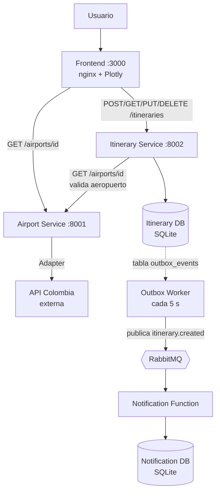
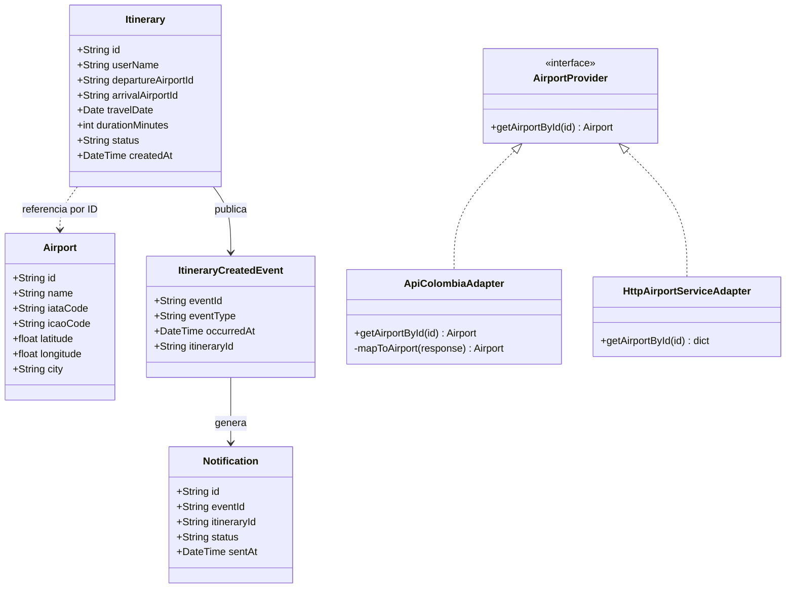
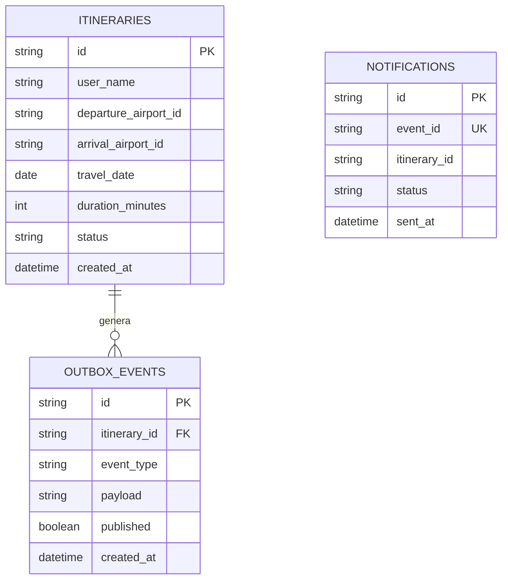
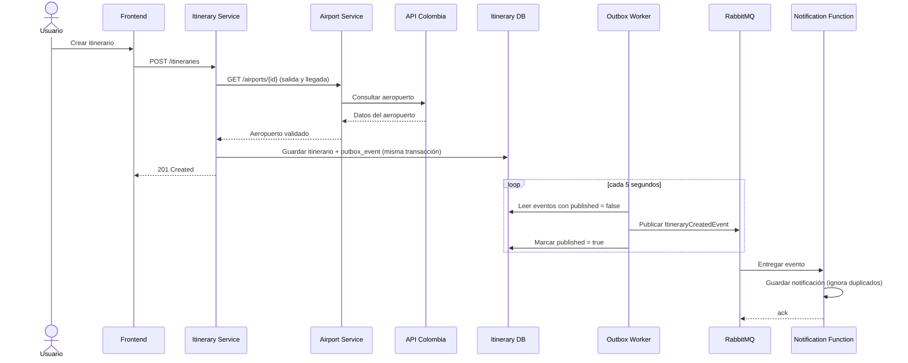
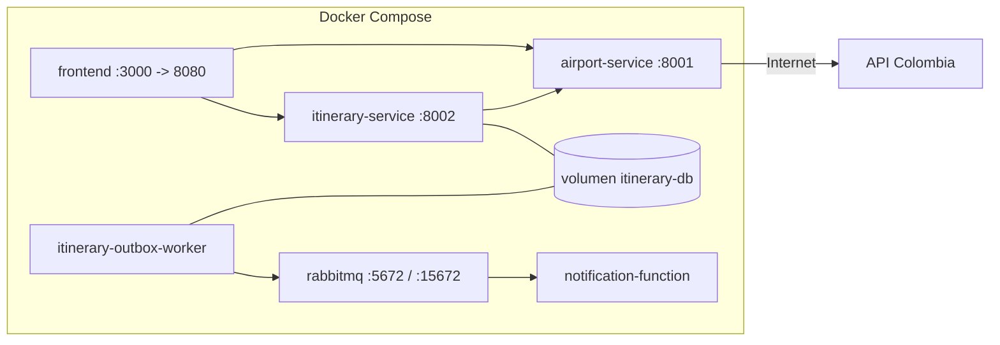

# Sistema de Itinerarios Personales

Proyecto de **Arquitectura de Software Emergentes** (Universidad Central).
Autor: Johan Arturo González Lemus.

Sistema distribuido que permite consultar aeropuertos colombianos desde una API pública, verlos en un mapa interactivo (Plotly), crear y gestionar itinerarios validando que los aeropuertos existan, y notificar la creación de cada itinerario de forma asíncrona.

Integra tres estilos arquitectónicos:

| Arquitectura | Dónde se aplica |
|---|---|
| Microservicios | `airport-service` e `itinerary-service`, cada uno con su propio código, contenedor y base de datos |
| Basada en eventos | `itinerary-service` publica `ItineraryCreatedEvent` en RabbitMQ usando Transactional Outbox |
| Serverless (simulado) | `notification-function` reacciona a eventos del broker y guarda el historial en su propia base de datos |

## Contenido

1. [Arquitectura utilizada](#1-arquitectura-utilizada)
2. [Diagrama de componentes](#2-diagrama-de-componentes)
3. [Diagrama de clases](#3-diagrama-de-clases)
4. [Diagrama relacional](#4-diagrama-relacional)
5. [Diagrama de secuencia](#5-diagrama-de-secuencia)
6. [Diagrama de despliegue](#6-diagrama-de-despliegue)
7. [Contextos delimitados y lenguaje ubicuo (DDD)](#7-contextos-delimitados-y-lenguaje-ubicuo-ddd)
8. [Decisión sobre el agregado Aeropuerto](#8-decisión-sobre-el-agregado-aeropuerto)
9. [Eventos de dominio vs eventos de integración](#9-eventos-de-dominio-vs-eventos-de-integración)
10. [Patrón Adapter](#10-patrón-adapter)
11. [Flujo asíncrono de notificaciones](#11-flujo-asíncrono-de-notificaciones)
12. [Double Write Problem y Transactional Outbox](#12-double-write-problem-y-transactional-outbox)
13. [Observabilidad](#13-observabilidad)
14. [Instrucciones para ejecutar el proyecto](#14-instrucciones-para-ejecutar-el-proyecto)
15. [Metodología DevOps](#15-metodología-devops)
16. [Evidencias de funcionamiento](#16-evidencias-de-funcionamiento)
17. [Tabla de autoevaluación](#17-tabla-de-autoevaluación)
18. [Trabajo futuro](#18-trabajo-futuro)

---

## 1. Arquitectura utilizada

Cada microservicio sigue **arquitectura hexagonal** con tres capas bien separadas:

- **domain**: entidades y puertos (interfaces). No depende de frameworks ni de infraestructura.
- **application**: casos de uso que orquestan el dominio.
- **infrastructure / api**: adaptadores concretos (HTTP, base de datos, RabbitMQ) y rutas FastAPI.

Estructura del repositorio (monorepo, un servicio por carpeta):

```
.
├── docker-compose.yml
├── airport-service/          # Consulta API Colombia (patrón Adapter). Sin base de datos.
├── itinerary-service/        # CRUD de itinerarios, Alembic, Outbox y worker
├── notification-function/    # Consumidor de eventos (RabbitMQ) con su propia BD
└── frontend/                 # Mapa Plotly + gestión de itinerarios (nginx)
```

Reglas de diseño que se respetan:

- El frontend **solo** conoce los microservicios propios, nunca la API externa.
- `itinerary-service` valida aeropuertos llamando por HTTP a `airport-service`, no a API Colombia.
- Una base de datos por servicio; no se comparten tablas.
- El dominio depende de interfaces (puertos), nunca de implementaciones concretas.

## 2. Diagrama de componentes



## 3. Diagrama de clases



`ApiColombiaAdapter` vive en `airport-service` y traduce la API externa. `HttpAirportServiceAdapter` vive en `itinerary-service` e implementa su propio puerto `AirportProvider`, apuntando al Airport Service.

## 4. Diagrama relacional

Cada servicio tiene su propia base de datos. `airport-service` no persiste datos.



`ITINERARIES` y `OUTBOX_EVENTS` están en la base del Itinerary Service (migración Alembic `84112cbead5f`). `NOTIFICATIONS` está en la base de la Notification Function; no hay clave foránea entre bases, solo el identificador lógico del itinerario.

## 5. Diagrama de secuencia



> Nota: aún no existe API Gateway. Cuando se agregue (Nivel 2), el frontend hablará con el gateway y este enrutará hacia los servicios.

## 6. Diagrama de despliegue



El worker y el Itinerary Service usan la misma imagen con comandos distintos y comparten el volumen donde vive la base SQLite.

## 7. Contextos delimitados y lenguaje ubicuo (DDD)

Se definen tres contextos delimitados, cada uno con su propio modelo y su propia base de datos.

| Contexto | Responsabilidad | Servicio |
|---|---|---|
| **Airports** | Conocer aeropuertos colombianos y exponerlos en un formato estable | `airport-service` |
| **Itineraries** | Gestionar itinerarios de viaje y garantizar que los aeropuertos existan | `itinerary-service` |
| **Notifications** | Reaccionar a la creación de itinerarios y registrar la notificación | `notification-function` |

### Lenguaje ubicuo

**Airports**
- *Aeropuerto*: lugar de salida o llegada, con nombre, ciudad, códigos y coordenadas.
- *Código IATA / OACI*: identificadores internacionales del aeropuerto (OACI = ICAO).
- *Proveedor de aeropuertos* (`AirportProvider`): puerto que abstrae de dónde salen los datos.
- *Adapter*: traductor del formato de API Colombia al modelo interno.

**Itineraries**
- *Itinerario*: plan de viaje de un usuario entre un aeropuerto de salida y uno de llegada.
- *Aeropuerto de salida / llegada*: referencias por identificador a aeropuertos del contexto Airports.
- *Estado*: situación del itinerario (`CREATED` al crearlo).
- *Evento pendiente (outbox)*: hecho que debe comunicarse a otros contextos y aún no se publicó.

**Notifications**
- *Notificación*: registro de que se avisó de la creación de un itinerario.
- *Evento de integración*: mensaje recibido desde el broker.
- *Idempotencia*: procesar dos veces el mismo evento no genera dos notificaciones.

### Relación entre contextos

- Itineraries consume a Airports de forma síncrona (HTTP), como cliente de su API.
- Notifications consume eventos de Itineraries de forma asíncrona (RabbitMQ).
- Ningún contexto accede a la base de datos de otro.

## 8. Decisión sobre el agregado Aeropuerto

**Decisión: referencia de valor por identificador, no agregado completo.**

`Itinerary` guarda únicamente `departure_airport_id` y `arrival_airport_id`. El aeropuerto pertenece al contexto Airports y el contexto Itineraries no copia ni modifica sus datos.

Motivos:

- Respeta los límites de contexto: Itineraries no necesita conocer coordenadas ni códigos.
- Evita datos duplicados que se desactualicen.
- La existencia se valida por HTTP en el momento de crear o actualizar el itinerario.

Consecuencia aceptada: si Airports no está disponible, no se puede crear un itinerario (el servicio responde `503`). Una copia local optimizada del aeropuerto (Nivel 2/3) reduciría esa dependencia.

## 9. Eventos de dominio vs eventos de integración

| | Evento de dominio | Evento de integración |
|---|---|---|
| Alcance | Dentro de un contexto | Entre contextos / servicios |
| Qué expresa | Algo relevante que ocurrió en el negocio | Un mensaje estable que otros servicios consumen |
| Ejemplo aquí | "Se creó un itinerario" dentro de Itineraries | `ItineraryCreatedEvent` publicado en RabbitMQ (routing key `itinerary.created`) |
| Transporte | Memoria / misma transacción | Broker de mensajería |

En este proyecto el hecho "se creó un itinerario" se registra como fila en `outbox_events` dentro de la misma transacción, y el worker lo publica como evento de integración para que Notifications lo consuma.

## 10. Patrón Adapter

El Airport Service define un **puerto** (`AirportProvider`) y un **Adapter concreto** (`ApiColombiaAdapter`) que traduce la respuesta externa al modelo de dominio `Airport`.

```
API Colombia (formato externo)  →  ApiColombiaAdapter  →  Airport (dominio)  →  AirportResponse (API propia)
```

El Adapter absorbe las particularidades de la API externa para que el resto del sistema no las conozca:

- El código OACI llega como `oaciCode` y se mapea a `icao_code`.
- Latitud y longitud pueden llegar invertidas; el Adapter las detecta con el rango geográfico de Colombia y las corrige.
- La ciudad llega como objeto anidado y se aplana a texto.
- Errores de red, timeout y respuestas `4xx/5xx` se traducen a `AirportProviderUnavailableError`.

El frontend solo conoce el formato adaptado del Airport Service. Si API Colombia cambia, solo se toca el Adapter.

## 11. Flujo asíncrono de notificaciones

1. El usuario crea un itinerario (`POST /itineraries`).
2. El Itinerary Service valida los aeropuertos y guarda itinerario y evento pendiente en una sola transacción.
3. El **Outbox Worker** revisa la tabla `outbox_events` cada 5 segundos y publica los eventos pendientes en el exchange `itinerary_events` de RabbitMQ.
4. RabbitMQ entrega el mensaje a la cola de notificaciones.
5. La **Notification Function** lo procesa, guarda la notificación en su base y confirma (`ack`).
6. Si el mismo evento llega dos veces, la restricción única sobre `event_id` lo rechaza y se ignora (entrega *at-least-once* con consumo idempotente).
7. Si RabbitMQ aún no está listo al arrancar, la función reintenta la conexión.

## 12. Double Write Problem y Transactional Outbox

**El problema:** al crear un itinerario hay que escribir en la base de datos y publicar un evento en el broker. Son dos sistemas distintos y no se pueden confirmar en una sola transacción. Si se guarda el itinerario y falla la publicación, el itinerario existe pero nadie se entera; si se publica y falla el guardado, se notifica algo que no existe.

**La solución aplicada (Transactional Outbox):**

1. El itinerario y el evento se guardan **en la misma transacción** de la base del Itinerary Service (tabla `outbox_events`). O se guardan ambos o ninguno.
2. Un proceso aparte (**Outbox Worker**) lee los eventos con `published = false`, los publica en RabbitMQ y los marca como publicados.
3. Si RabbitMQ está caído, el evento sigue pendiente y se publica cuando vuelva.

Garantía resultante: ningún evento se pierde. Puede haber reenvíos, por eso el consumidor es idempotente.

## 13. Observabilidad

- **Logs estructurados en JSON** en `airport-service` e `itinerary-service`, con `timestamp`, `level`, `service`, `correlation_id` y `message`.
- Un middleware genera o recibe el encabezado `X-Correlation-Id` en cada petición y lo devuelve en la respuesta.
- `itinerary-service` propaga ese identificador al llamar a `airport-service`, así se puede seguir una misma petición entre ambos servicios.
- Endpoint `/health` en los servicios HTTP.
- **Calidad:** análisis automático con SonarCloud en cada Pull Request (Quality Gate obligatorio).

## 14. Instrucciones para ejecutar el proyecto

Requisitos: Docker Desktop y Git.

```bash
git clone https://github.com/Johaanart/airport-service.git
cd airport-service
docker-compose up -d --build
```

Cuando los contenedores estén activos (`docker-compose ps`):

| Componente | URL |
|---|---|
| Frontend (mapa + itinerarios) | http://localhost:3000 |
| Airport Service (Swagger) | http://localhost:8001/docs |
| Itinerary Service (Swagger) | http://localhost:8002/docs |
| RabbitMQ (gestión) | http://localhost:15672 (usuario y contraseña `guest`, solo desarrollo local) |

Ver que la notificación se procesó:

```bash
docker logs notification-function
```

Pruebas (con un entorno virtual de Python activo):

```bash
cd airport-service && pytest
cd ../itinerary-service && pytest
```

Migraciones del Itinerary Service:

```bash
cd itinerary-service
alembic upgrade head
```

Apagar todo:

```bash
docker-compose down
```

## 15. Metodología DevOps

Ciclo: Plan → Code → Build → Test → Release → Deploy → Operate → Monitor.

Flujo de trabajo por tarea:

1. Tarea en Trello.
2. Rama Git por tarea (`feature/...`, `fix/...`).
3. Desarrollo y pruebas locales.
4. Commit y push de la rama.
5. Pull Request con análisis de SonarCloud.
6. Merge a `main` cuando el Quality Gate pasa.
7. Actualizar Trello y pasar a la siguiente tarea.

## 16. Evidencias de funcionamiento

> Pendiente de agregar antes de la entrega: capturas o video corto.

- [ ] Mapa Plotly con aeropuertos (`http://localhost:3000`).
- [ ] Creación de un itinerario y notificación generada (`docker logs notification-function`).
- [ ] Swagger de ambos servicios.
- [ ] Quality Gate de SonarCloud en verde.
- [ ] Base de datos funcional (tablas `itineraries`, `outbox_events`, `notifications`).

## 17. Tabla de autoevaluación

### Nivel 1: base

| Criterio | Estado | Por qué |
|---|---|---|
| Patrón Adapter | Cumple | Puerto `AirportProvider` y `ApiColombiaAdapter` que traduce al dominio |
| Arquitectura hexagonal | Cumple | Capas domain / application / infrastructure / api en cada servicio |
| DDD básico | Cumple | Secciones 7 y 8 de este README |
| CRUD de itinerarios | Cumple | POST, GET, PUT, DELETE con validación de aeropuertos vía HTTP |
| Base de datos relacional | Cumple | SQLite por servicio con persistencia en volumen |
| Migraciones | Cumple | Alembic en `itinerary-service` (Airport Service no persiste datos) |
| Swagger | Cumple | `/docs` en ambos servicios HTTP |
| Manejo de errores | Cumple | `404`, `422`, `503` con cuerpo `detail` consistente |
| Logs estructurados | Cumple | JSON con `correlation_id` propagado entre servicios |
| Frontend con Plotly | Cumple | Mapa de aeropuertos consumiendo Airport Service |
| Docker + docker-compose | Cumple | 6 contenedores orquestados con healthcheck en RabbitMQ |
| README y diagramas | Cumple | Este documento |

### Nivel 2: avanzado

| Criterio | Estado |
|---|---|
| Notification Service | Cumple (`notification-function`) |
| Broker de mensajería | Cumple (RabbitMQ) |
| Circuit Breaker | Pendiente |
| Retry con backoff | Pendiente (solo reintento de conexión a RabbitMQ) |
| Cache Redis | Pendiente |
| API Gateway | Pendiente |
| AsyncAPI | Pendiente |
| Trazas distribuidas (Jaeger) | Pendiente |
| Propagación de JWT | Pendiente |
| Pruebas E2E | Pendiente |
| Demostración de resiliencia | Pendiente |

### Nivel 3: experto

| Criterio | Estado |
|---|---|
| Transactional Outbox | Cumple (tabla outbox + worker) |
| Consistencia distribuida (Double Write) | Cumple (sección 12) |
| CI/CD | Parcial (SonarCloud en cada PR; falta pipeline de build, test y deploy) |
| Resto (gRPC, mTLS, Vault, Chaos, Bulkhead, Alerting, Kubernetes, Pact, versionado) | Pendiente |

## 18. Trabajo futuro

- Endpoint `GET /airports` para no depender de un rango de identificadores en el frontend.
- Circuit breaker, retry con backoff y caché Redis en el Airport Service.
- API Gateway con rate limiting y JWT.
- Contrato AsyncAPI del exchange `itinerary_events`.
- OpenTelemetry + Jaeger para trazas distribuidas.
- Pipeline de GitHub Actions (build, test, push).
- Credenciales de RabbitMQ por variables de entorno.
- Mejora visual del mapa (rutas, resaltado de salida y llegada).